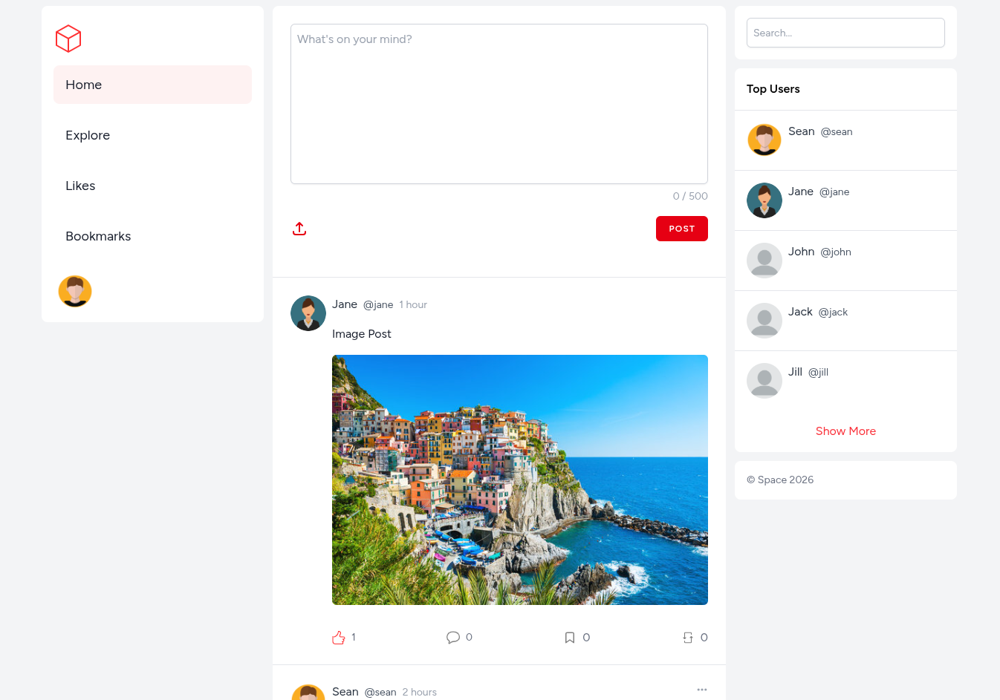

# Space

Space is a social microblogging application built with Laravel and Vue.js

## Installation

1. Run `git clone https://github.com/smtack/space.git && cd space`
2. Run `composer run setup`
3. Run `mkdir -p storage/app/public/avatars storage/app/public/images && cp public/images/default.webp storage/app/public/avatars/ && php artisan storage:link` to enable avatars and post images.
3. Run `composer run dev` to start the development server.

## License

The Laravel framework is open-sourced software licensed under the [MIT license](https://opensource.org/licenses/MIT).